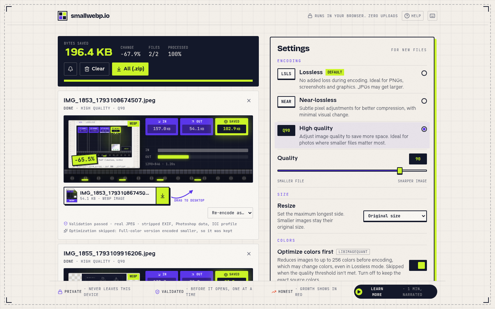

# smallwebp.io

**Convert images to WebP in your browser. Nothing is uploaded.**

[**Open smallwebp.io →**](https://smallwebp.io)

smallwebp.io turns JPG, PNG, GIF, BMP, WebP and AVIF files into WebP. The encoder runs on your device as WebAssembly, so your images never leave your computer. There is no account, no watermark and no limit on the number of files.

This repository holds the documentation and is where problems and ideas are tracked. To report something, [open an issue](https://github.com/popcornbag8891-blip/SmallWebP/issues/new/choose).

## What it does

- **Three modes**
  - **Lossless** (default): stores the pixels it receives exactly. Best for PNGs, screenshots, logos and graphics.
  - **Near-lossless**: the same lossless engine, with very small pixel adjustments that compress better.
  - **High quality**: lossy WebP with a quality slider from 40 to 100 (default 90). Best for photos.
- **Color optimization** with libimagequant (the engine behind pngquant). It reduces an image to up to 256 colors before encoding, and is skipped when the palette can't meet a high quality threshold. It is on by default and can be turned off to skip color reduction. Use Lossless at original size to preserve source pixels.
- **Animated GIFs stay animated**, keeping every frame's timing and the loop count.
- **Batch conversion** of many files or whole folders, with one ZIP download that keeps the folder paths.
- **Optional resize** to a maximum longest side. Smaller images keep their size.
- **Before/after comparison** with a live quality tuner that re-encodes the real image.
- **Honest sizes**: if a WebP comes out bigger than the original, it is shown in red.
- **Metadata is not copied**: EXIF (including GPS location), XMP and comments are left out of the WebP.

## Privacy

Everything runs in your browser. The libwebp encoder and the libimagequant color optimizer run as WebAssembly in a Web Worker, and the site's Content Security Policy blocks connections to other servers. Only your settings (mode, quality, resize, sound) are saved, in your browser's local storage. Nothing about your files is stored.

## File validation

Before a file is opened, smallwebp.io:

- reads the real file type from its first bytes instead of trusting the extension,
- checks the file size (up to 50 MB) and the declared dimensions (up to 16,383 px per side and 50 megapixels),
- rejects files that contain known script patterns or appended archives and programs.

Files are processed one at a time. This catches malformed and disguised files, but it is **validation, not a virus scanner**, and it can't guarantee that any file is safe. Files that pass are decoded by your browser's own image decoder.

## Supported formats

| In | Out |
| --- | --- |
| JPG / JPEG / JFIF, PNG, GIF (including animated), BMP, WebP, AVIF | WebP |

Not supported: HEIC/HEIF, TIFF, SVG, ICO, PSD, RAW camera files, JPEG XL and PDF. SVG is refused on purpose, because it can contain scripts.

## Browsers

Works in current versions of Chrome, Edge, Firefox and Safari, on desktop and mobile (iPhone, iPad, Android). Dragging a finished file to the desktop works in Chrome and Edge.

## Keyboard shortcuts

| Keys | Action |
| --- | --- |
| Ctrl/⌘ + V | Paste images from the clipboard |
| Ctrl/⌘ + S | Download every finished file as a ZIP |
| Ctrl/⌘ + Z | Undo the last remove or clear |
| Delete | Remove the selected file |
| ? | Show all shortcuts |

## Built with

[libwebp](https://chromium.googlesource.com/webm/libwebp) and [jSquash](https://github.com/jamsinclair/jSquash) for encoding, [libimagequant](https://pngquant.org/lib/) for color optimization, React, Vite, Tailwind CSS and Framer Motion.

## Reporting problems

- **Something not working?** Use the [bug report form](https://github.com/popcornbag8891-blip/SmallWebP/issues/new?template=bug_report.yml).
- **An idea?** Use the [feature request form](https://github.com/popcornbag8891-blip/SmallWebP/issues/new?template=feature_request.yml).
- **A security issue?** Please read [SECURITY.md](SECURITY.md) and don't post it publicly.

Please don't attach private images to issues. Issues are public.

## License

[MIT](LICENSE)
