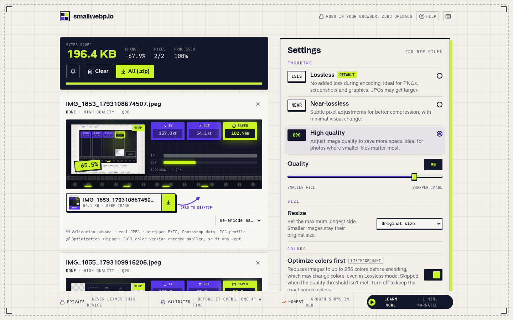

# smallwebp.io

**Convert images to WebP in your browser. Nothing is uploaded.** Or from ChatGPT, Claude and other AI assistants.

[**Open smallwebp.io →**](https://smallwebp.io)



smallwebp.io turns JPG, PNG, GIF, BMP, WebP, AVIF, HEIC, TIFF and Photoshop (PSD) files into WebP, or into AVIF if you choose. The encoders run on your device as WebAssembly, so your images never leave your computer. There is no account, no watermark and no limit on the number of files.

This repository holds the documentation and is where problems and ideas are tracked. To report something, [open an issue](https://github.com/popcornbag8891-blip/SmallWebP/issues/new/choose).

## What it does

- **Four modes**
  - **Auto** (default): picks per file from its verified type. JPG, WebP, AVIF and HEIC get High quality at 90; PNG, GIF, BMP, TIFF and PSD get Lossless. Each result shows what Auto chose, for example "Auto → Q90".
  - **Lossless**: stores the pixels it receives exactly. Best for PNGs, screenshots, logos and graphics.
  - **Near-lossless**: the same lossless engine, with very small pixel adjustments that compress better.
  - **High quality**: lossy WebP with a quality slider from 40 to 100 (default 90). Best for photos.
- **Color optimization** with libimagequant (the engine behind pngquant). It reduces an image to up to 256 colors before encoding, and is skipped when the palette can't meet a high quality threshold. It is off by default in Lossless, so Lossless at original size keeps the source pixels, and on by default in Near-lossless and High quality. In Auto it runs only on files Auto encodes in High quality. The choice is saved separately for each mode.
- **WebP or AVIF output**: WebP by default. AVIF (made by libavif) can be lossless or use the quality you pick; in our tests it came out 21–47% smaller than WebP at the same look, at one to two seconds per megapixel. Near-lossless exists only for WebP, so it saves AVIFs lossless; animated GIFs stay animated WebP; AVIFs are saved without a color profile, in sRGB.
- **Animated GIFs stay animated**, keeping every frame's timing and the loop count.
- **Batch conversion** of many files or whole folders, with one ZIP download that keeps the folder paths.
- **Optional resize** to a maximum longest side. Smaller images keep their size.
- **Before/after comparison** with a live quality tuner that re-encodes the real image.
- **Honest sizes**: if a WebP comes out bigger than the original, it is flagged with the increase written out as a percentage.
- **Metadata is not copied**: EXIF (including GPS location), XMP and comments are left out of the new file.
- **Optional color profile**: off by default, which converts colors to sRGB and drops the ICC profile. Turn on "Keep color profile" to embed the source's profile (for example Display P3 or Adobe RGB) in the WebP with the original color values, for JPG, PNG, WebP, AVIF, HEIC, TIFF and PSD files that carry an RGB profile (WebP output only). CMYK and grayscale profiles are not kept, because they can't describe the WebP's RGB colors.

## Privacy

On the website, everything runs in your browser. The libwebp and libavif encoders, the libheif decoder and the libimagequant color optimizer run as WebAssembly in Web Workers, and the site's Content Security Policy blocks connections to other servers. Only your settings (mode, quality, output format, resize, color optimization, color profile, sound) are saved, in your browser's local storage. Nothing about your files is stored.

The separate converter for AI assistants (below) runs on a server: images sent to it are converted in memory and discarded, and only the result is kept, under a random link, for 1 hour.

Full details: [smallwebp.io/privacy](https://smallwebp.io/privacy/). Security contact: [security.txt](https://smallwebp.io/.well-known/security.txt).

## AI assistants

Add `https://smallwebp.io/mcp` as a custom connector (remote MCP server, no sign-in) in ChatGPT, Claude, Cursor or VS Code, then ask the assistant to convert an image. In Claude, attached files work once its code sandbox may reach smallwebp.io (Settings → Capabilities: network egress, allowed domains); otherwise share a public link. It uses the same encoders and settings as the website and returns a download link that works for 1 hour. Without an assistant:

```sh
curl -H "Content-Type: application/octet-stream" --data-binary @photo.jpg -o photo.webp "https://smallwebp.io/api/convert?mode=lossy&quality=85&file_name=photo.jpg"
```

Setup steps and limits: [smallwebp.io/ai](https://smallwebp.io/ai/).

## File validation

Before a file is opened, smallwebp.io:

- reads the real file type from its first bytes instead of trusting the extension,
- checks the file size (up to 50 MB) and the declared dimensions (up to 16,383 px per side and 50 megapixels),
- rejects files that contain known script patterns or appended archives and programs.

Files are processed one at a time. This catches malformed and disguised files, but it is **validation, not a virus scanner**, and it can't guarantee that any file is safe. Files that pass are decoded by your browser's own image decoder, or for HEIC, TIFF and PSD by a decoder that loads only for those files and runs in the same worker.

## Supported formats

| In | Out |
| --- | --- |
| JPG / JPEG / JFIF, PNG, GIF (including animated), BMP, WebP, AVIF | WebP (default) or AVIF |
| HEIC / HEIF still images | WebP or AVIF |
| TIFF, 8 or 16 bits: uncompressed, LZW, ZIP/Deflate, PackBits, JPEG or CCITT fax; first page only | WebP or AVIF |
| PSD / PSB, any color mode at 1–32 bits. Uses Photoshop's flattened copy when present; otherwise rebuilds the picture from the layers (blend modes, groups, clipping and vector masks, artboards, solid and gradient fills; layer styles and adjustment layers are skipped with a note) | WebP or AVIF |

Not supported: SVG, ICO, RAW camera files, JPEG XL and PDF. SVG is refused on purpose, because it can contain scripts. Also refused with a message: HEIC files that hold only a burst or animation, and TIFFs with Zstandard compression.

## Browsers

Works in current versions of Chrome, Edge, Firefox and Safari, on desktop and mobile (iPhone, iPad, Android). Dragging a finished file to the desktop works in Chrome and Edge.

## Keyboard shortcuts

| Keys | Action |
| --- | --- |
| Ctrl/⌘ + V | Paste images from the clipboard |
| Ctrl/⌘ + S | Download every finished file as a ZIP |
| Ctrl/⌘ + Z | Undo the last remove or clear |
| Delete | Remove the selected file |
| ? | Show all shortcuts |

## Built with

[libwebp](https://chromium.googlesource.com/webm/libwebp) and [jSquash](https://github.com/jamsinclair/jSquash) for encoding, [libimagequant](https://pngquant.org/lib/) for color optimization, React, Vite, Tailwind CSS and Framer Motion.

## Reporting problems

- **Something not working?** Use the [bug report form](https://github.com/popcornbag8891-blip/SmallWebP/issues/new?template=bug_report.yml).
- **An idea?** Use the [feature request form](https://github.com/popcornbag8891-blip/SmallWebP/issues/new?template=feature_request.yml).
- **A security issue?** Please read [SECURITY.md](SECURITY.md) and don't post it publicly.

Please don't attach private images to issues. Issues are public.

## License

[MIT](LICENSE)
